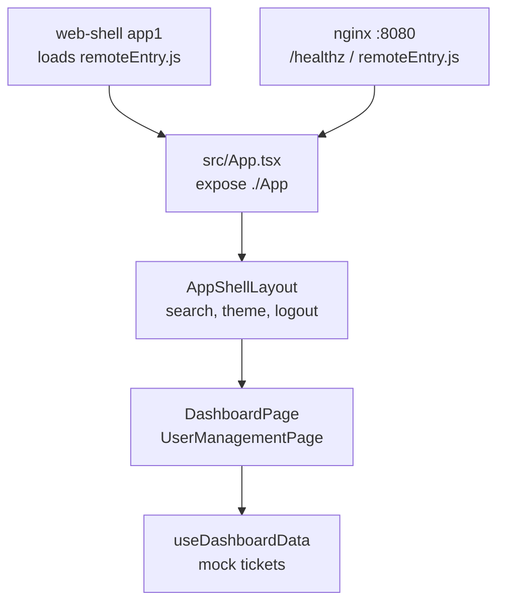
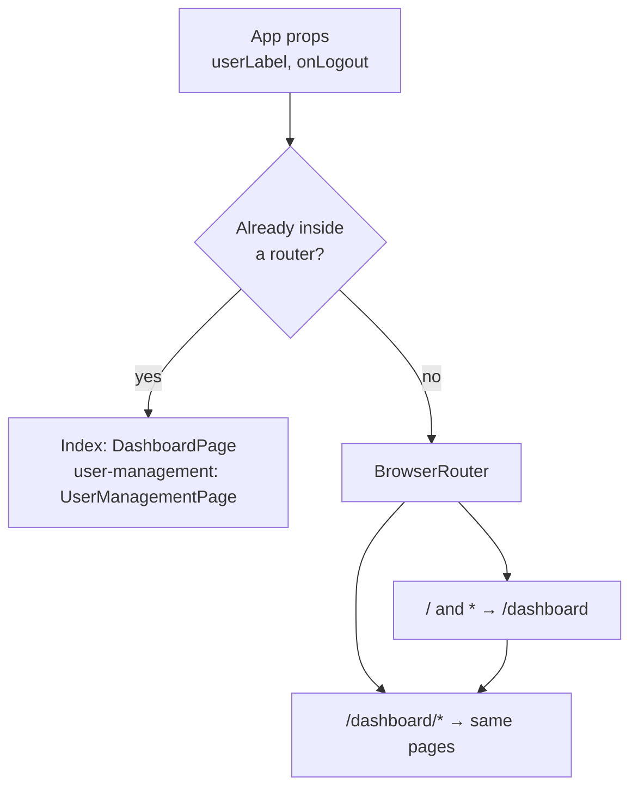
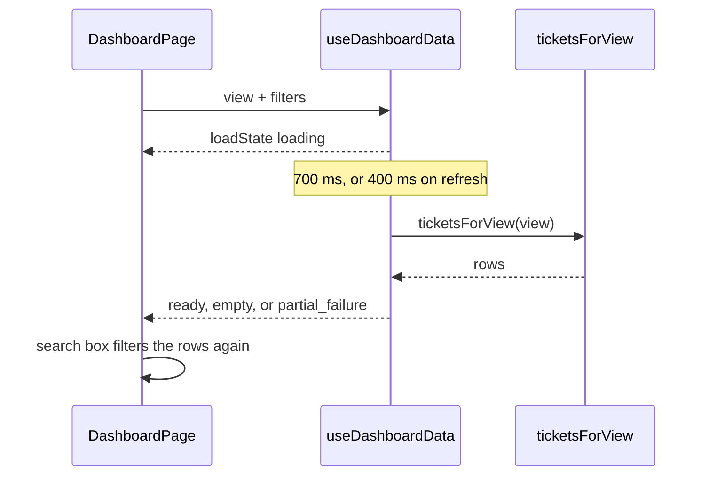

# Architecture

`mfe-dashboard` is the Module Federation remote **`app2`**. The shell (`web-shell`, container `app1`) loads `remoteEntry.js` and renders `./App`. This process does not authenticate users and does not call a backend. Ticket and user rows are fixtures in the bundle.

Diagram sources live in [docs/architecture/mermaid/](docs/architecture/mermaid). The fences below match those files.

## Layers

> Source: `docs/architecture/mermaid/layer-model.mmd`

| Module | Responsibility |
|---|---|
| `src/main.tsx` | Standalone entry: applies the stored theme, then mounts `<App />` on `#app`. Throws if `#app` is missing. Used when this repo is the page. The shell imports `./App` and does not run `main.tsx` |
| `src/App.tsx` | Exposed module and standalone root. Contract props `userLabel?` and `onLogout?`; without them `useCurrentUser` and `useSignOut` from the SDK. Picks embedded or own routing; the basename is `workspaceBasename()` (SDK `slugFromPath`, as web-shell) |
| `src/layouts/AppShellLayout.tsx` | Sidebar, search box, theme picker, user menu. Publishes `{ search }` on the outlet context |
| `src/pages/DashboardPage.tsx` | Views, filter drawer, KPI cards, empty / loading / partial states |
| `src/hooks/useDashboardData.ts` | `setTimeout` 700 ms to load, 400 ms to refresh, then filters the fixture |
| `src/pages/UserManagementPage.tsx` | Filters the mock user list by the outlet search string |
| `src/theme/themeMode.ts` | `appTheme` and `themeMode` in the SDK's `storage('app2')` |
| `nginx/default.conf` | Port 8080, `/healthz`, no-cache `remoteEntry.js`, immutable hashed chunks, CORS on both |

The build is Rsbuild 2 with the platform SDK's plugin (`rsbuild.config.ts`, `pluginPlatform({ role: 'remote', name: 'app2', exposes: { './App': './src/App.tsx' } })`). The preset's shared map makes `react`, `react-dom` (`^19.0.0`), `@opentelemetry/api` and every SDK subpath strict singletons provided by the shell; the SDK is never bundled here. `react-router-dom` is not shared, so `App` runs its own `BrowserRouter` with the basename read from the URL (`routerBasename`: everything before `/dashboard`). The exposed module's CSS is a lazily loaded chunk next to `remoteEntry.js`. Only async chunks are split: a split entry would start asynchronously and leave `window.app2` as a Promise, which the SDK's `loadRemote` refuses.

## Routing

> Source: `docs/architecture/mermaid/routing.mmd`

`useInRouterContext()` is the branch. The shell already owns `/dashboard/*`, so the remote's routes are relative (`/` and `user-management`). Opened alone, `BrowserRouter` redirects `/` and unknown paths to `/dashboard`.

Sidebar links are absolute (`/dashboard`, `/dashboard/user-management`), which matches the standalone router and the shell's URL. The user-management link and route need `manage:members` (`useHasPermission`); without it the route navigates back to the dashboard. "All Tenders In Flight" needs `read:tender`.

## Ticket load

> Source: `docs/architecture/mermaid/ticket-load.mmd`

`ticketsForView` in `src/mocks/dashboardTickets.ts`:

| View | Rows |
|---|---|
| `my-tickets` | `status === 'open'` and not delegated, sorted by SLA then due date |
| `awaiting-review` | `status === 'review'` |
| `awaiting-approval` | `status === 'approval'` |
| `delegated` | `delegatedFrom` is set |
| `all-tenders` | every fixture when `canSeeAllTenders` is true, otherwise `[]` |
| anything else | `[]` |

The page passes `canSeeAllTenders: true` (`CAN_SEE_ALL_TENDERS`). Load state is `partial_failure` when the view is `my-tickets` and a row has `tenderDetailsUnavailable` (ticket `T-1015`). Status, department, role (`roleLevel.includes`), and tender title are applied in the hook. **Deadline is counted by `countActiveFilters` and is not applied.** The search box filters title, client, and department after the hook returns.

KPI numbers come from `KPI_COUNTS` in `src/mocks/dashboardStats.ts`. They are not the length of the fixture list.

## Logout and theme

`onLogout` from the shell runs as-is. Without it, inside the shell, `App` calls the SDK's `useSignOut()` (global sign-out); if that rejects because the shell provides no `signOut`, it falls back to the default. The default, used in standalone mode, is `window.location.assign` of `VITE_APP1_URL` with one trailing slash removed. The default value is `http://localhost:5001`. It is read at click time from `import.meta.env`, which `rsbuild.config.ts` (`source.define`) inlines at build time.

Theme keys:

| Key | Values |
|---|---|
| `appTheme` | `light`, `dark`, or a daisyUI theme id |
| `themeMode` | `light` or `dark`, written only for Aura themes |

`readStoredAppTheme` prefers `appTheme`, then `themeMode`, then `light`.

## Browser storage

| Key | Store | Contents |
|---|---|---|
| `appTheme` | SDK `storage('app2')` (`localStorage`, namespaced per workspace) | Theme id |
| `themeMode` | SDK `storage('app2')` | `light` or `dark` |

The SDK clears both on logout and workspace switch, and refuses token-like keys. Before sign-in (standalone) it writes nothing.

No tokens are written. Search text stays in React state.

## Image

`Dockerfile` builds with Node 26 (`npm ci` with the BuildKit secret `npm_token` for GitHub Packages), deletes source maps, and copies `dist` into `nginxinc/nginx-unprivileged:1.31-alpine` after `apk upgrade`. `USER 101`. Listen 8080. Build args that affect the bundle: `VITE_APP1_URL` (default `http://localhost:5001`), plus `BUILD_VERSION` and `SOURCE_DATE_EPOCH` for labels and reproducibility.

`.dockerignore` excludes `.env`, so a value has to be a build arg. `VITE_APP1_URL` is declared as an `ARG`, which avoids baking an empty logout URL.

## Failure domains

| Failure | What the user sees |
|---|---|
| Fixture row marked `tenderDetailsUnavailable` | Banner "Tickets are retained below" and the right-panel error. The row stays |
| Filters match nothing | "No tickets found" |
| Search matches nothing | "No matching tickets" |
| `#app` missing in standalone bootstrap | `main.tsx` throws before render |
| Shell and remote React ranges diverge | Federation fails in the shell; this repo cannot detect that at build time |

## Invariants

- Expose path is `./App` and the container name is `app2`.
- Shared `requiredVersion` ranges match web-shell.
- `onLogout` is optional. The fallback URL is build-time only.
- `/healthz` returns `ok` on port 8080.
- Coverage gate is 95% on all four metrics, enforced by `.github/scripts/coverage-gate.mjs`.

## Testing

Vitest does not load `rsbuild.config.ts`, so the federation plugin is not in the test runner. End-to-end tests render `<App />` inside `MemoryRouter` for the embedded branch and alone for `BrowserRouter`. Hook tests use fake timers and a stable filters object.

## Threat notes

| Item | Note |
|---|---|
| `VITE_APP1_URL` | Fixed at build. Logout is an open navigation to that origin. Do not take it from the query string |
| Theme in SDK storage | Any script in the page origin can read it. It is not a credential, and the SDK clears it on logout |
| Mock data | Includes sample names and emails. They are not accounts |
| Remote execution | The shell runs this bundle in the shell origin. A substituted `remoteEntry.js` is the shell's supply-chain problem; this image is signed (see [VERSIONING.md](VERSIONING.md)) |

## Decisions

| Decision | Why |
|---|---|
| Custom chrome inside the remote | The shell passes only `userLabel` and `onLogout`. Navigation for tickets lives here |
| Relative routes when embedded | The shell already mounted `/dashboard/*` |
| `USER 101` | The unprivileged nginx image's uid. `USER nginx` fails Hadolint DL3066 |
| Coverage script instead of a Vitest threshold | Same gate the shell uses, overridable with `COVERAGE_THRESHOLD` |
| Deadline counted but not applied | The drawer badge reflects the control. The hook has no deadline predicate. Called out in the changelog so it is not mistaken for a filter |

## Documentation

[docs/README.md](docs/README.md) indexes the pipeline map and the runbooks.
