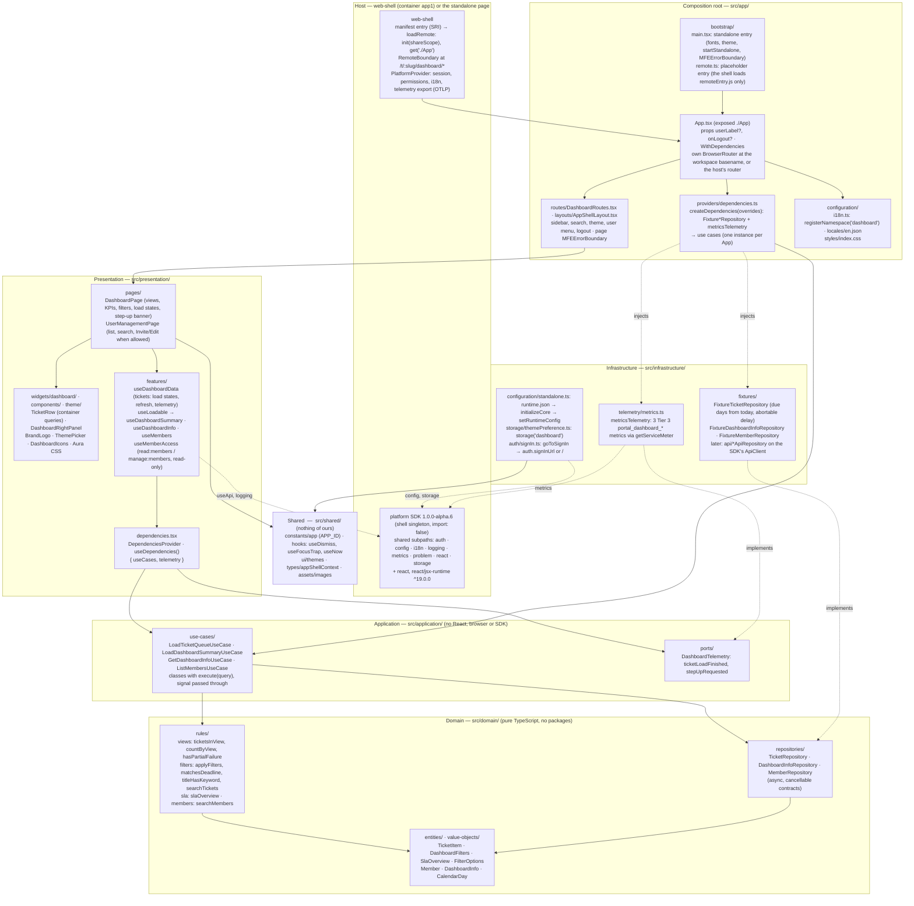
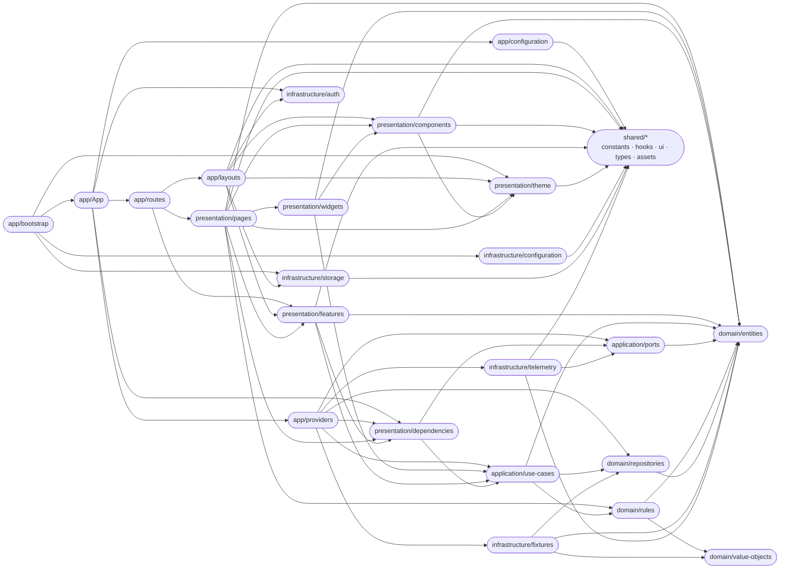
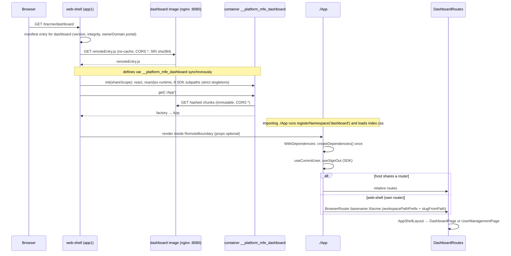
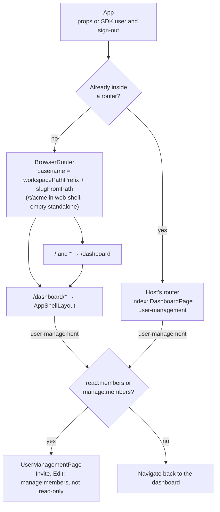
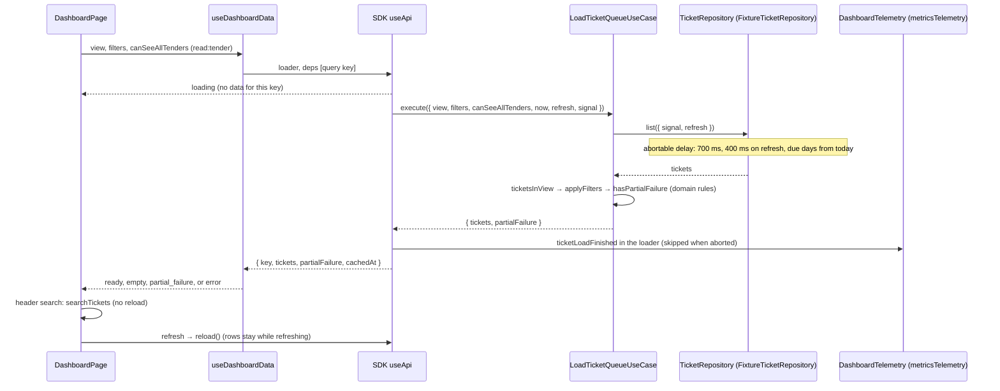
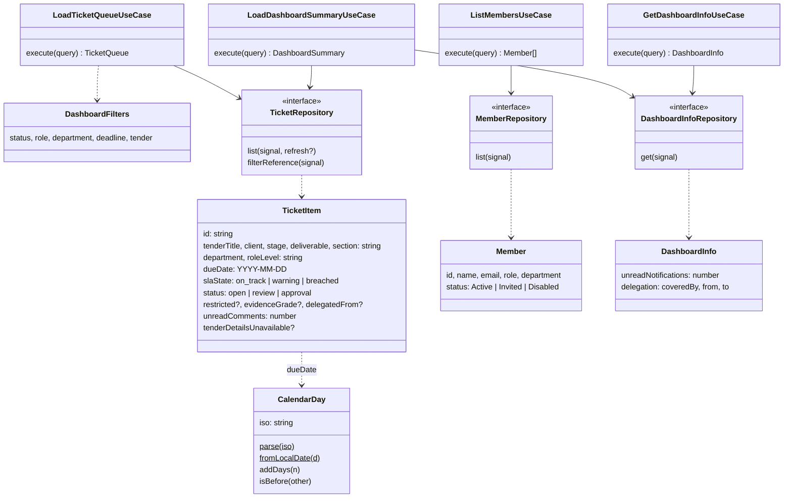
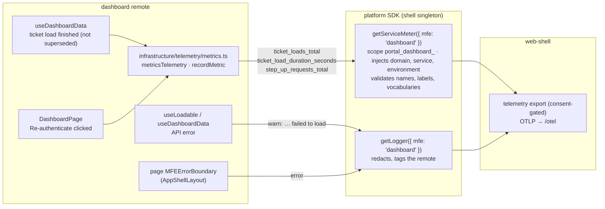
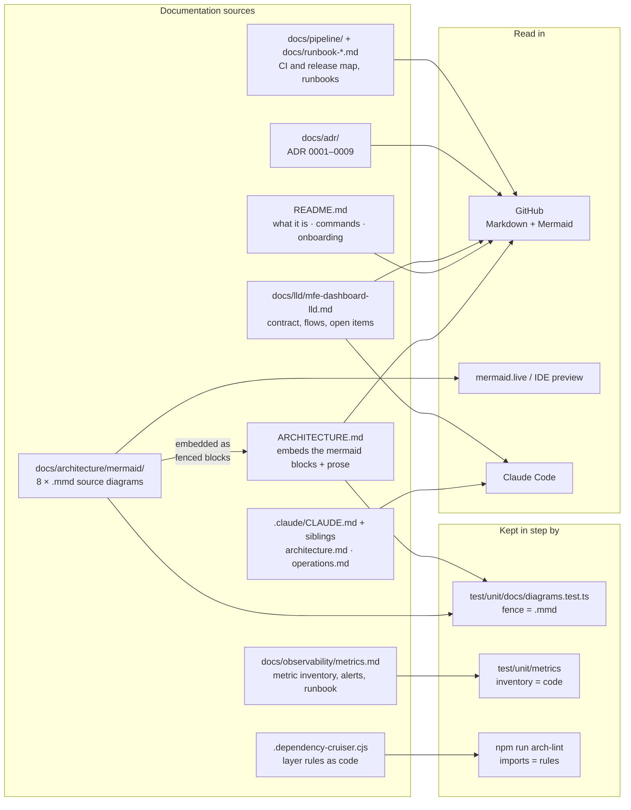

# Architecture

This document describes the internal structure, dependency rules and runtime flows of `mfe-dashboard`.

`mfe-dashboard` is the **Module Federation remote `dashboard`** (`github.com/BCBP-SOLUTIONS-FZC-LLC/mfe-dashboard`). It exposes `./App`, and web-shell (container `app1`) mounts it at `/t/<slug>/dashboard/*`. The same code also runs as a **standalone page**: `npm run dev` on port 5002, and the image's `/`. It is built with React 19, React Router 7, Tailwind 4 with daisyUI 5, and Rsbuild 2 using the platform preset. The image is nginx 1.31 (unprivileged) on port 8080.

One build makes two environments:
- **remote:** `remoteEntry.js` and its chunks. It takes the platform SDK from the shell.
- **standalone:** `index.html` and `assets/`, with the SDK bundled.

The platform SDK (`@bcbp-solutions-fzc-llc/frontend-sdk` `1.0.0-alpha.6`, from platform-reactcommon) provides everything it covers: user, sign-out, permissions, data loading, text, dates, storage, logging and metrics. This repository does not reimplement any of it.

**Status (2026-11-06):** `v0.3.0` is released, and `main` is on the alpha.6 platform packages, unreleased. The data comes from in-repo fixtures behind repository contracts; there are no backend calls yet ([LLD §15](docs/lld/mfe-dashboard-lld.md#15-open-items)).

**Owns:**
- the dashboard: views, KPIs, filters, load states, the right panel;
- the User management UI;
- the remote's chrome: sidebar, search, theme, user menu;
- the `dashboard` message catalog, the themes and the nginx image.

**Does not own:**
- sign-in, tokens, session, sign-out and workspace switching (the SDK's `/auth` in web-shell);
- roles (IAM) and the role → permission map (web-shell `src/platform/permissions.ts`);
- authorisation (IAM and the APIs: checks in this UI are hints);
- the remote manifest, SRI and the kill switch (web-shell and the SDK's `/mfe`);
- hosting in an environment.

The contract, flows and open items are in detail in the [LLD](docs/lld/mfe-dashboard-lld.md); the decisions are in the [ADRs](docs/adr/README.md). Every diagram below is embedded from `docs/architecture/mermaid/`, and `test/unit/docs/diagrams.test.ts` fails when a fence and its `.mmd` file differ.

---

## Layer model

`src/` follows the Frontend Architecture Constitution's layers ([ADR 0001](docs/adr/0001-layered-structure.md)). Dependencies point inward:
- `app` is the composition root;
- `presentation` renders and calls use cases;
- `application` holds the use cases and ports;
- `domain` holds entities, value objects, rules and repository contracts;
- `infrastructure` implements the contracts and ports;
- `shared` depends on nothing of ours.

> Source: `docs/architecture/mermaid/layer-model.mmd`

| Layer | Contents | May import (ours) | Packages |
|---|---|---|---|
| `src/app/` | `App.tsx` (the exposed `./App`); `bootstrap/` (`main.tsx` standalone entry, `remote.ts` placeholder); `routes/DashboardRoutes.tsx`; `layouts/AppShellLayout.tsx`; `providers/dependencies.ts`; `configuration/` (i18n catalog); `styles/` | every layer | yes |
| `src/presentation/` | `pages/`, `widgets/dashboard/`, `components/`, `features/` (hooks that run use cases through `useApi`), `theme/`, `dependencies.tsx` | application, domain, shared | yes |
| `src/application/` | `use-cases/` (classes with `execute()`), `ports/` (`DashboardTelemetry`) | domain, shared | **no** |
| `src/domain/` | `entities/`, `value-objects/` (`CalendarDay`), `rules/`, `repositories/` (contracts) | nothing | **no** |
| `src/infrastructure/` | `fixtures/` (repository implementations), `configuration/standalone.ts`, `storage/themePreference.ts`, `telemetry/metrics.ts`, `auth/signIn.ts` | application, domain, shared | yes |
| `src/shared/` | `constants/app.ts` (`APP_ID`), `hooks/` (`useDismiss`, `useFocusTrap`, `useNow`), `ui/themes.ts`, `types/appShellContext.ts`, `assets/` | nothing | yes |

**The rule.** Dependencies flow `app` → `presentation` → `application` → `domain`. `infrastructure` sits beside `presentation`: it implements the domain's repositories and the application's ports, and only `app/providers/dependencies.ts` imports it to wire it in. One exception: `app/layouts` and `app/bootstrap` also call `infrastructure/auth`, `/storage` and `/configuration` directly, which the composition root may do.

Pages and widgets never import infrastructure. They get `{ useCases, telemetry }` through `useDependencies()`. `domain/` and `application/` import no package at all (no React, SDK or router) and use no browser API.

Two checks enforce this, and a new layer rule goes into both:
- **`npm run arch-lint`** (`.dependency-cruiser.cjs`, the CI step `Architecture lint` in Validate / Quality). It is written like iam-org-membership's `.go-arch-lint.yml`: one commented component per layer, a `mayDependOn` allow-list (anything not allowed fails), and `anyVendorDeps` (the layers allowed to import packages).
- **`test/unit/architecture/layers.test.ts`**. It also checks what an import graph cannot see: the set of top-level folders, and browser globals (`window`, `fetch`, `localStorage`) in `domain/` and `application/`.

**Regressions to watch:**
- **Two configuration bugs that let violations through.** The first arch-lint config filtered the graph with `includeOnly: '^src/'`, which hid every package import, so `domain → react` passed. It also excluded an unanchored `dist/`, which hid the SDK (`node_modules/…/frontend-sdk/dist/`). Both are fixed, and the config now anchors `exclude` to the repository root. To check a change to `.dependency-cruiser.cjs`, inject a violation and make sure it is reported, then restore the file.
- **Wiring in a page.** Pages used to import sample data and the metrics module directly. The composition root now injects both. A page that needs a new data source gets a repository contract in `domain/repositories`, an implementation in `infrastructure/`, and its wiring in `app/providers/dependencies.ts`.

---

## Module dependency graph

The arrows are `import` relationships between folders inside `src/`, taken from dependency-cruiser's graph of the current code. This graph mirrors `.dependency-cruiser.cjs` folder by folder.

> Source: `docs/architecture/mermaid/module-dependencies.mmd`

**Sinks and leaves:**
- `domain/entities` is the dependency sink.
- `domain/value-objects` (`CalendarDay`) has no imports.
- `shared/*` imports nothing of ours.
- `application/ports` imports only domain types.

**Imports that are allowed but look odd:**
- `presentation/widgets → application/use-cases` is a type-only import of `DashboardSummary`.
- `presentation/pages → domain/rules` covers `searchTickets` and `searchMembers`: filtering in memory as the user types, with no reload.

**What the linter does not check:** `test/`, `scripts/`, `config/` and the build output are outside its scope, so `test/fixtures/dependencies.tsx` importing `app/providers` is not part of the checked runtime graph.

**Other forbidden rules, beyond the allow-list:**
- `presentation-no-sdk-data-access`: no SDK `storage`, `metrics` or `config` in presentation;
- `no-telemetry-libraries`: no OpenTelemetry, prom-client or web-vitals;
- `no-server-state-libraries`: no TanStack Query, SWR, axios or ky (ADR 0002);
- `no-circular`: no import cycles;
- `src-not-to-test`: `src/` never imports `test/`;
- `no-unresolvable`: every import resolves.

### What comes from the SDK

| Concern | SDK API | Used in |
|---|---|---|
| User, sign-out | `useCurrentUser`, `useSignOut` | `app/App.tsx` |
| Workspace basename, route names | `slugFromPath`, `tryGetConfig().auth.workspacePathPrefix`, `useRouteTemplate` | `app/routes` |
| Access | `useHasPermission`, `useReadOnly`, `useStepUp` | `presentation/features/members`, `DashboardPage` |
| Data loading, errors | `useApi`, `isProblemError`, `problemMessage`, `getLogger` | `presentation/features`, `DashboardPage` |
| Render errors | `MFEErrorBoundary` | `app/layouts` (the page), `app/bootstrap/main.tsx` (standalone) |
| Text, dates, numbers | `registerNamespace`, `useT`, `useLocale`, `formatDate` (incl. `'YYYY-MM-DD'`), `formatNumber` | `app/configuration`, presentation |
| Per-app storage | `storage('dashboard')` | `infrastructure/storage` |
| Metrics | `getServiceMeter` | `infrastructure/telemetry/metrics.ts` only |
| Host-page start-up (standalone) | `loadRuntimeConfig`, `initializeCore`, `setRuntimeConfig` | `infrastructure/configuration/standalone.ts` only |

`npm run lint` (`@bcbp-solutions-fzc-llc/eslint-plugin`) and `test/unit/sdk/dependency-rules.test.ts` reject the usual reimplementations:
- `Intl` formatters and `fetch`;
- reading tokens or cookies, identity headers, raw browser storage;
- role-name checks and hand-built workspace paths;
- SDK deep imports or root imports;
- shell-only SDK APIs (`loadRemote`, the manifest, auth, flags, starting telemetry);
- any `console` call;
- a `Date` built from a `YYYY-MM-DD` literal.

---

## Mount flow

How web-shell loads and renders the remote. Standalone, `app/bootstrap/main.tsx` is the host instead:
1. it applies the stored theme;
2. `startStandalone()` loads `/config/runtime.json` and sets the page identity and the config;
3. it renders `App` inside the SDK's `MFEErrorBoundary`.

> Source: `docs/architecture/mermaid/mount-flow.mmd`

**What has to hold for this to work:**
- **`remoteEntry.js` must define its container global synchronously.** Rsbuild splits only async chunks (`splitChunks: { chunks: 'async' }`), and the dev server has no HMR or live-reload client. A split entry, or an injected dev client, starts the container asynchronously; `window.__platform_mfe_dashboard` is then a Promise, and `loadRemote` refuses it.
- **Shared modules:** the remote takes `react`, `react/jsx-runtime` (`^19.0.0`) and eight SDK subpaths (`auth`, `config`, `i18n`, `logging`, `metrics`, `problem`, `react`, `storage`; `^1.0.0-alpha.6`, `import: false`) from the shell as strict singletons. There is no fallback copy of the SDK: without the shell's, `get('./App')` fails and the shell's `RemoteBoundary` shows the error.
- **`react-router-dom` is not shared.** Inside web-shell the remote runs its own `BrowserRouter` at the workspace basename.
- **Proof:** `test/integration/remote-entry.test.tsx` builds the remote and loads it through `init(shareScope)` / `get('./App')`, as web-shell does.

---

## Routing

> Source: `docs/architecture/mermaid/routing.mmd`

`useInRouterContext()` decides which branch runs:
- **Inside web-shell:** the remote mounts its own `BrowserRouter` at `workspacePathPrefix + slugFromPath` (`/t/acme`), giving `/t/acme/dashboard` and `/t/acme/dashboard/user-management`.
- **A host that shares a router:** the remote uses relative routes.
- **Standalone:** there is no workspace, so no basename, and `/` and unknown paths redirect to `/dashboard`.

Paths and access:
- An unknown nested path returns to the dashboard (`Navigate to=".." relative="route"`).
- `useRouteTemplate('/t/:slug/dashboard/user-management')` names the nested route's template: the shell registers only `/t/:slug/dashboard`.
- "All Tenders In Flight" needs `read:tender`.
- User management follows IAM LLD §10.4 through web-shell's role map: any active member may view (`read:members`), and `tenant_admin` and `tenant_owner` may manage (`manage:members`).

---

## Data flow

Every load goes the same way: a feature hook → the SDK's `useApi` → a use case (`execute`, with the abort signal) → a repository contract, implemented today by an in-repo fixture.

> Source: `docs/architecture/mermaid/ticket-load.mmd`

| Hook | Use case | Repositories | Failure shown as |
|---|---|---|---|
| `useDashboardData` | `LoadTicketQueueUseCase` | `TicketRepository.list` | Load state `error`: alert with the SDK's `problemMessage` and Retry |
| `useDashboardSummary` (`useLoadable`) | `LoadDashboardSummaryUseCase` | `TicketRepository.list` + `filterReference`, `DashboardInfoRepository.get` | Alert under the title with Retry; KPI cards show "—" |
| `useMembers` (`useLoadable`) | `ListMembersUseCase` | `MemberRepository.list` | Table row "Users could not be loaded." with Retry; "Loading users…" and `aria-busy` while loading |
| `useDashboardInfo` (`useLoadable`) | `GetDashboardInfoUseCase` | `DashboardInfoRepository.get` | No notification count (logged only) |

The views (`ticketsInView` in `domain/rules/views.ts`):

| View | Rows |
|---|---|
| `my-tickets` | `status === 'open'` and not delegated, most urgent SLA first, then by due day |
| `awaiting-review` | `status === 'review'` |
| `awaiting-approval` | `status === 'approval'`; the step-up banner shows when `useStepUp().needed` |
| `delegated` | `delegatedFrom` is set |
| `all-tenders` | every ticket with `read:tender`, otherwise none |

**Filters and counts** (`applyFilters`):
- **Status and department** must match exactly.
- **Role** matches a substring of `roleLevel`, so "Reviewer" matches "Senior Reviewer".
- **Tender** matches whole words of the title (`titleHasKeyword`), so "IT" does not match "Hospital".
- **Deadline** compares local calendar days (`matchesDeadline`): `overdue` is before today; `week` is today and the next six days.
- **Search:** the header search (`searchTickets`) filters the loaded rows again, with no reload.
- **KPI counts** are `countByView`, the same rows each view lists.
- **The SLA overview** counts `my-tickets` by `slaState`.

**Composition root.** `createDependencies(overrides)` builds every use case on its repositories and returns `{ useCases, telemetry }`. `App` creates it once, unless an outer `DependenciesProvider` supplies one. Tests use that path to inject a failing, slow or never-settling repository (`test/fixtures/dependencies.tsx`) instead of mocking modules. When the ticket, notification and membership APIs exist, `*ApiRepository` classes on the SDK's `ApiClient` replace the fixtures in `dependencies.ts`, and nothing above infrastructure changes.

---

## Domain model

> Source: `docs/architecture/mermaid/domain-model.mmd`

| Type | Notes |
|---|---|
| `TicketItem` | `dueDate` is a calendar day (`YYYY-MM-DD`), never an instant. `status` and `slaState` come from the ticket service; `tenderDetailsUnavailable` marks a row whose tender lookup failed (partial failure) |
| `CalendarDay` | Immutable; `parse` rejects anything that is not a real day; `fromLocalDate` is the viewer's local today; comparisons are string comparisons, so a day never shifts across time zones |
| `DashboardFilters` | `'all'` means no filter. Values come from the data (departments) and reference data (role levels, tender keywords) |
| `Member` | What User management lists; `status` `Active`, `Invited` or `Disabled` |
| `DashboardInfo` | Unread notifications and the delegation coverage period (calendar days) |
| Repository contracts | Every method is asynchronous and takes an `AbortSignal`, as an API call does |

**Sample data:**
- **Due days** are offsets from the local today (`sampleTicketsAt`), consistent with each SLA state: breached is past due; warning is due in 1–3 days; on track in 5 or more. The demo therefore always has overdue and this-week tickets. `test/unit/domain/filters.test.ts` checks this.
- **The delegation period** runs from two days before today to two days after.

---

## Data freshness and caching

There is no client-side cache of our own. Server state is the SDK's `useApi` (ADR [0002](docs/adr/0002-server-state-platform-sdk.md)), and UI state is React state (ADR [0003](docs/adr/0003-client-state-react.md)).

| Data | Where it lives | Lifetime |
|---|---|---|
| Ticket rows of the current query | `useApi` result, keyed by `JSON.stringify([view, filters, canSeeAllTenders])` | Until the key changes (a fresh load) or a refresh (the rows stay while reloading) |
| Summary, members, shell info | `useApi` result (`useLoadable`) | Until the component unmounts or Retry |
| "Last updated N mins ago" | `cachedAt` from the load + `useNow(30 s)` | Refreshes itself while rows are shown |
| Search text, filters, view, open drawer | React state | The page's lifetime |
| Theme | SDK `storage('dashboard')`: `appTheme`, `themeMode` | Across reloads while signed in; the SDK clears it on sign-out and workspace switch, and stores nothing while anonymous |

HTTP caching (`nginx/default.conf`):

| Path | Cache-Control | Why |
|---|---|---|
| `/remoteEntry.js` | `no-cache` | The entry names the current chunks; the shell must always get the latest |
| Hashed chunks `/<name>.<16 hex>.(js\|css)`, `/assets/*` | `public, max-age=31536000, immutable` | Content-addressed |
| `/config/runtime.json` | `no-cache` | Per environment, mounted over the image's default |
| The document (`/`, SPA routes, `/index.html`) | `no-cache` | Picks up a new release on reload |
| Other static files | `no-cache` | Not hashed |

---

## Access control

Permissions are **UI hints only**: IAM and the APIs authorise every request. The remote names permissions, never roles.

| Capability | Check | Where |
|---|---|---|
| "All Tenders In Flight" view and its rows | `useHasPermission('read', 'tender')` | `DashboardPage`; passed to the use cases as `canSeeAllTenders` |
| See User management (link and route) | `read:members` or `manage:members` | `useMemberAccess().canView`; the route navigates back without it |
| Invite user, Edit | `manage:members` and not `useReadOnly()` | `useMemberAccess().canManage` |
| Approve (awaiting approval) | Fresh MFA: `useStepUp().needed` shows the banner; `reauthenticate()` starts step-up and returns here | `DashboardPage` (counted as `portal_dashboard_step_up_requests_total`) |

A read-only tenant (suspended, or with an expired trial; the SDK's `useReadOnly`) gets no management actions, because IAM would answer them with 403. web-shell's `src/platform/permissions.ts` maps roles to these permissions.

---

## Concurrency

| Situation | Behaviour |
|---|---|
| View or filters change while a load runs | `useApi` aborts the superseded load (its signal); the fixture's delay clears its timer and never settles; no metric is recorded for it |
| Refresh while rows are shown | `refresh` marks the next load (`trigger="refresh"`, 400 ms); the rows stay and `refreshing` is true |
| A load fails, then Retry | `reload()`; the error stays until a load succeeds |
| React StrictMode (standalone) double effects | `useApi` owns the request lifecycle; the composition root is created once per `App` (`useState` initialiser) |
| Two tabs | Independent; the theme is per workspace in SDK storage, read at start |

---

## Observability

> Source: `docs/architecture/mermaid/observability.mmd`

**Metrics** are all Tier 3 (`portal_dashboard_*`), defined only in `src/infrastructure/telemetry/metrics.ts`, and listed in [docs/observability/metrics.md](docs/observability/metrics.md) with proposed alerts, SLOs and a runbook.

| Metric | Type | Labels |
|---|---|---|
| `portal_dashboard_ticket_loads_total` | counter | `view`, `trigger` (`initial`, `refresh`), `outcome` (`success`, `error`) |
| `portal_dashboard_ticket_load_duration_seconds` | histogram | `view`, `outcome` |
| `portal_dashboard_step_up_requests_total` | counter | — |

How the metrics are kept in check:
- **The SDK** scopes them by this remote's manifest entry (`ownerDomain` `portal`, service `dashboard`), injects `domain`, `service` and `environment`, and validates every point.
- **The types:** every label has a closed value set, typed through `recordMetric`.
- **The tests:** `test/unit/metrics` checks the definitions against the SDK's registry, and the inventory page against the code.
- **Standalone** there is no manifest, so nothing is recorded; a single warning is logged.

**Logs** go through `getLogger({ mfe: 'dashboard' })`. The SDK redacts each record and tags it with the remote, and the shell exports it:
- a failed ticket load is a `warn` (`dashboard tickets failed to load`);
- any other failed load is a `warn` (`<what> failed to load`, from `useLoadable`);
- a render error is logged by `MFEErrorBoundary`;
- a missing standalone config is a `warn`.

**Traces** are the shell's: the remote starts no telemetry of its own.

---

## Failure domains

**Invariants:**
- **FAIL-1:** an API error never blanks the page. It becomes a visible state with Retry: the ticket list, the summary alert, the member row. Only a non-API exception, which means a bug, reaches the page's `MFEErrorBoundary`. The sidebar keeps working, and the boundary clears when the path changes.
- **FAIL-2:** a partial failure keeps the data. Rows without tender details stay listed, under the "Tickets are retained below" banner and the right-panel error card.
- **FAIL-3:** the standalone page always renders. A missing, invalid or slow (over 5 s) `runtime.json` is logged; the page renders as `prod` (`local` on the dev server), and logout goes to `/`.
- **FAIL-4:** the remote never takes the shell down. A load failure, missing shared module or version mismatch fails inside the shell's `RemoteBoundary`.

**Degradation matrix:**

| Dependency | Fails how | Posture | What the user sees |
|---|---|---|---|
| Ticket API (fixture today) | API error, timeout, network | fail visible | Alert "Tickets could not be loaded." + problem message + Retry; rows cleared |
| Tender details for a row | `tenderDetailsUnavailable` | degrade | Row kept; banner and right-panel card |
| Summary (tickets + reference + info) | API error | fail visible | Alert with Retry; KPI "—", filter lists only "All", no right panel |
| Member API (fixture today) | API error | fail visible | Row "Users could not be loaded." + Retry |
| Notification and delegation info (chrome) | API error | degrade | No count; logged |
| Shell `signOut` | Absent (standalone) | fallback | Navigation to `auth.signInUrl`, else `/` |
| Shell SDK subpath, or SDK/React outside range | Load-time | fail closed | Shell's `RemoteBoundary` error |
| Metrics (no manifest entry) | Standalone | degrade | Nothing recorded; one warning |
| `runtime.json` (standalone) | Missing, invalid, slow | degrade | Renders; logout to `/` |

---

## Key invariants

| Invariant | Where enforced |
|---|---|
| Container `dashboard`, expose `./App`, `var __platform_mfe_dashboard` defined synchronously | Preset `containerName('dashboard')`; `test/integration/remote-entry.test.tsx`; smoke script greps the served `remoteEntry.js` |
| The SDK is never bundled into the remote, never a runtime dependency; its dev version equals web-shell's | `import: false` in the preset; the preset's `SdkVersionPlugin`; `test/unit/sdk/dependency-rules.test.ts` (peer range) |
| Layer directions, framework-free domain and application | `npm run arch-lint`; `test/unit/architecture/layers.test.ts` |
| No reimplementation of the SDK | `npm run lint`; `test/unit/sdk/dependency-rules.test.ts` |
| `./App` props are optional (`userLabel`, `onLogout`) | `DashboardAppProps`; tests render `<App />` with no props (`test/unit/app/remote.test.tsx`, `test/integration`) |
| Access by permission, never by role name | `dependency-rules.test.ts`; `test/unit/authz` |
| Every UI string is a catalog key, and every key is used | `test/unit/i18n/catalog.test.ts` |
| No environment-specific value compiled in; only `BUILD_VERSION` | `test/integration/remote-entry.test.tsx` ("build once, deploy everywhere"); ADR 0006 |
| Calendar days never become instants | `CalendarDay`; `dependency-rules.test.ts` rejects `new Date('YYYY-MM-DD')` |
| No raw browser storage, tokens, identity headers or unsafe HTML | `npm run lint` |
| Images and fonts imported, never root-relative | Code review; the smoke script's nested-route check |
| Layout classes are logical (RTL) | Code review (`ps/pe`, `start/end`, `text-start`) |
| WCAG 2.1 AA | `test/browser` (axe-core, light, dark, open drawer) |
| Metrics follow the observability standard | `test/unit/metrics` |
| Diagrams equal their sources | `test/unit/docs/diagrams.test.ts` |
| Coverage ≥ 95% on all four metrics; every domain file > 90% | `.github/scripts/coverage-gate.mjs` |
| `/healthz` answers `ok` on 8080; no source maps in the image | Smoke script |

---

## Deployment

### Image

| Stage | Base | What happens |
|---|---|---|
| builder | `node:26-bookworm` (digest-pinned) | `npm ci` with the BuildKit secret `npm_token` (GitHub Packages), `npm run build` (`tsc`, both Rsbuild environments, `remote-manifest-entry.json`), source maps deleted |
| runtime | `nginxinc/nginx-unprivileged:1.31-alpine` (digest-pinned) | `apk upgrade`, nginx config, `dist/` owned by 101; `USER 101`, port 8080 |

Build args: `BUILD_VERSION`, `SOURCE_DATE_EPOCH`. Nothing environment-specific is a build arg (ADR [0006](docs/adr/0006-runtime-configuration-only.md)). An environment mounts its own `/config/runtime.json`, with `environment` and `auth.signInUrl`, over the shipped default. Each build writes `remote-manifest-entry.json`: web-shell's manifest entry with the sha384 integrity of `remoteEntry.js`.

### nginx

| Request | Answer |
|---|---|
| `/healthz` | `200 ok` |
| `/remoteEntry.js`, hashed chunks, `/assets/*` | The file, with `Access-Control-Allow-Origin: *` and `Cross-Origin-Resource-Policy: cross-origin` (the shell loads them cross-origin) |
| A path without a static-asset extension | `index.html`, with the document headers |
| A missing file; anything under `/api`, `/otel`, `/csp-report`, `/config`, `/remotes`; dotfiles | `404`, never `index.html` (platform-reactcommon `examples/cloudfront/spa-rewrite.js`) |

| Headers | Where |
|---|---|
| `X-Content-Type-Options: nosniff`, `Referrer-Policy` | Every response (`security-headers.conf`) |
| CSP `default-src 'self'` (scripts, styles, fonts, connect same-origin; `frame-ancestors 'none'`), `X-Frame-Options: DENY`, `Permissions-Policy`, `X-Robots-Tag: noindex` | The standalone document (`document-headers.conf`) |
| gzip on, `server_tokens off` | Server |

### Release

A tag `vX.Y.Z` runs `release.yml`. The image is tagged only after it has been scanned, its provenance exported and it has been signed, so no tag ever points at an unchecked image:

1. validate (tests and quality);
2. build the `dist` tarball and `remote-manifest-entry.json`;
3. push the image by digest, with a BuildKit SBOM and SLSA provenance;
4. scan it with Trivy;
5. export the provenance (`imagetools inspect`);
6. sign it with Cosign;
7. tag it `X.Y.Z`, `X.Y`, `X` and `latest`;
8. create the GitHub Release.

There is no deploy job. An environment takes the manifest entry from the same release and ships it with a web-shell on the same platform packages. Details: [LLD §12.5](docs/lld/mfe-dashboard-lld.md#125-release), [docs/pipeline/README.md](docs/pipeline/README.md), [docs/runbook-release.md](docs/runbook-release.md).

**CI on every pull request** (`ci.yml`):
- `Validate / Test`, `Validate / Quality` (lint, arch-lint, audit, workflow hygiene);
- `Browser (Playwright, axe)`;
- `Build image (cache)` (Hadolint);
- `Trivy CVE scan`, `Smoke tests`, `PR summary`;
- `changelog`.

On `main`, `Push image → GHCR` waits for all of them.

---

## Testing strategy

| Suite | Location | What it proves |
|---|---|---|
| Unit | `test/unit/<area>/` (`architecture`, `domain`, `application`, `app`, `authz`, `dashboard`, `components`, `theme`, `i18n`, `metrics`, `sdk`, `docs`) | Domain rules and use cases with no React; hooks and pages against a fresh SDK test platform (`startPlatform()`); the layer, SDK, i18n, metrics and diagram rules |
| Integration | `test/integration/remote-entry.test.tsx` | Builds the remote with Rsbuild in a child process. Proves: the container is defined synchronously; the SDK is not bundled; only shell-provided modules are consumed; lazy stylesheets are pinned by sha384; images load from the remote's own public path; `./App` renders through `init(shareScope)` / `get('./App')` with the shell's singletons and fails without the SDK; no environment-specific value is compiled in |
| E2E | `test/e2e/app-flows.test.tsx` | Whole-app flows in happy-dom: filter, search and log out under a host router; search users and fall back to the shell on logout; the standalone redirect onto the dashboard routes; the self-refreshing "Last updated" label and the filter drawer's keys |
| Browser | `test/browser/` (Playwright, Chromium) | Journeys on the production build of the standalone page (views, filters, search, nested-route reload, logout to `auth.signInUrl`) and axe-core WCAG 2.1 AA on the dashboard, the open filter drawer and the dark theme. happy-dom has no layout or colour; this suite caught a collapsed ticket row and 11 contrast failures |
| Smoke | `.github/scripts/smoke-tests.sh` (CI) | The image: size ≤ 200 MB, `/healthz`, the document and `remoteEntry.js` served, the container global, no source maps, nested-route assets, the SPA rule, `runtime.json`, manifest integrity equals the served file, security headers |

Some test conventions:
- Tests inject dependencies with `withDependencies()` / `testDependencies()` instead of mocking SDK or `src` modules.
- `.github/scripts/coverage-gate.mjs` holds 95% on statements, branches, functions and lines, and more than 90% on every file in `src/domain/`. The latest run measured 99.07% statements.

---

## Host conformance checklist

Before a shell loads this remote, check the following. web-shell does all of it today.

**Loading**
- [ ] The manifest entry for `dashboard` comes from this release's `remote-manifest-entry.json` (`entry`, `version`, `integrity` sha384, `ownerDomain: portal`). Do not hand-edit the integrity.
- [ ] The shell is on the same platform packages (SDK, preset, ESLint plugin) as this build. A different preset major or pre-release names the container differently and cannot load it.
- [ ] The share scope provides `react` and `react/jsx-runtime` `^19.0.0` and the SDK subpaths `auth`, `config`, `i18n`, `logging`, `metrics`, `problem`, `react` and `storage` as singletons.
- [ ] `remoteEntry.js` is loaded with SRI and is not cached by the shell (`no-cache`).

**Mounting**
- [ ] Mount `./App` at `/t/:slug/dashboard/*` inside a `RemoteBoundary`. Its props are optional: `userLabel` and `onLogout`.
- [ ] Do not share `react-router-dom`, or share a router and accept relative routes. The remote picks its mode with `useInRouterContext()`.
- [ ] The shell's runtime config sets `auth.workspacePathPrefix` (`/t/`), so the remote computes the same basename.

**Platform services**
- [ ] `PlatformProvider` supplies the session, permissions (`read:tender`, `read:members`, `manage:members`), read-only state, step-up, locale and storage namespace.
- [ ] The role → permission map grants `read:members` to every active member, and `manage:members` to `tenant_admin` and `tenant_owner`.
- [ ] Telemetry export is started by the shell, so this remote's metrics and logs leave the browser.
- [ ] The CSP allows scripts from the remote's origin. Images are emitted as hashed assets from that origin.

---

## Contract lifecycle

| Contract | Changes how | Kept in step by |
|---|---|---|
| `./App` and its props | Additive and optional only | `DashboardAppProps`; a breaking change is a major version ([VERSIONING.md](VERSIONING.md)) |
| Container name and global | Owned by the preset (`containerName`) | Upgrading platform packages together with web-shell |
| Platform packages | Same version as web-shell, upgraded manually (Dependabot ignores them) | `SdkVersionPlugin`; the peer range test |
| Remote manifest entry | Regenerated by every build | Smoke script compares the integrity with the served file |
| Message catalog `dashboard` | Keys added with the UI; unused keys fail | `test/unit/i18n/catalog.test.ts` |
| Metrics | New names need the observability standard and, for shared names, registry approval | `test/unit/metrics`; `docs/observability/metrics.md` |
| Runtime config | The SDK's `RuntimeConfigSchema` | `test/unit/app/runtime-config-files.test.ts` validates the shipped files |

---

## Threat model

STRIDE, limited to what this repository controls.

| STRIDE | Threat | Component | Mitigation |
|---|---|---|---|
| **Spoofing** | A forged `remoteEntry.js` is served in place of this one | Shell ↔ image | The shell pins `remoteEntry.js` by sha384 SRI from the release's manifest entry; the image is signed with Cosign and carries SLSA provenance |
| **Spoofing** | A user is shown actions for a role they do not hold | Presentation | Access by permission from the shell's session; UI checks are hints, and IAM authorises every call |
| **Tampering** | The image is altered after release | Registry | Pushed by digest, tagged only after scan and signature; base images digest-pinned |
| **Tampering** | Script injection through ticket or member text | Pages | React escapes all text; no `dangerouslySetInnerHTML` (lint `no-unsafe-html`); standalone CSP `script-src 'self'` with no inline script |
| **Repudiation** | An action with no trace | — | The remote performs no writes today; when it does, the APIs and Audit Log record them. Load failures are logged through the SDK |
| **Information disclosure** | Tokens or identity read or stored by the remote | Whole bundle | No tokens, cookies or identity headers (lint and `dependency-rules.test.ts`); only the theme is stored, through SDK storage, cleared on sign-out |
| **Information disclosure** | Source code or config leaked from the image | nginx | Source maps deleted; dotfiles, `/api`, `/config` (except `runtime.json`) return 404; `server_tokens off`; `.dockerignore` excludes `.env` |
| **Information disclosure** | The standalone page framed or indexed | nginx | `frame-ancestors 'none'`, `X-Frame-Options: DENY`, `X-Robots-Tag: noindex` |
| **Denial of service** | A crash in the remote takes down the shell | Shell boundary | The shell's `RemoteBoundary` and the page's `MFEErrorBoundary`; failed loads become states, not exceptions |
| **Elevation of privilege** | An open redirect at logout | `auth/signIn.ts` | `auth.signInUrl` only from the environment's `runtime.json`, validated by the SDK (`https`; `http` only for local, dev and test); never from the URL |
| **Elevation of privilege** | A read-only tenant performs management actions | User management | `useReadOnly()` hides them; IAM answers 403 regardless |

**Out of scope:**
- sign-in, MFA and sessions (Keycloak and web-shell);
- the manifest, kill switch and CSP of the shell document (web-shell);
- API authorisation (IAM and the APIs);
- hosting, TLS and the CDN (each environment).

---

## Developer tools

| Tool | Command | Purpose |
|---|---|---|
| Dev server | `npm run dev` (port 5002, `strictPort`) | The remote for a local web-shell (CORS open, no HMR: reload the shell by hand) and the standalone page; serves `config/runtime.local.json` as `/config/runtime.json` |
| Preview | `npm run preview` | The production build on port 5002 |
| Architecture lint | `npm run arch-lint` | Layer rules (`.dependency-cruiser.cjs`) |
| Lint | `npm run lint` | Platform ESLint rules, React hooks |
| Tests | `npm test`, `npm run test:ci`, `npm run test:browser` | All suites; coverage gate; Playwright + axe (report uploaded as a CI artifact) |
| Image | `docker build --secret id=npm_token,env=NODE_AUTH_TOKEN -t mfe-dashboard:dev .`, then `IMAGE=mfe-dashboard:dev bash .github/scripts/smoke-tests.sh` | The image and the CI smoke checks locally |
| Pre-commit hook | `npm run hooks:install` | Copies `.githooks/pre-commit` into `.git/hooks` |

---

## Decisions

The ADRs record the major decisions ([docs/adr/README.md](docs/adr/README.md)); this table also keeps the smaller ones and their reasons.

| Decision | Why |
|---|---|
| Constitution layers, enforced by arch-lint and a test | Business rules independent of React and the SDK; data access behind repositories. ADR [0001](docs/adr/0001-layered-structure.md), [0004](docs/adr/0004-repositories-and-composition-root.md) |
| SDK `useApi` for server state, React state for UI state (not TanStack Query or Zustand) | One request lifecycle with the shell; small local state. ADR [0002](docs/adr/0002-server-state-platform-sdk.md), [0003](docs/adr/0003-client-state-react.md) |
| The SDK for user, sign-out, access, data loading, text, storage and routing | One implementation across shell and remotes; the SDK is the shell's singleton, so session, locale and storage namespace are shared. ADR [0005](docs/adr/0005-localization-platform-sdk.md), [0007](docs/adr/0007-observability-platform-sdk.md) |
| Runtime configuration only | Build once, deploy everywhere. ADR [0006](docs/adr/0006-runtime-configuration-only.md) |
| Playwright and axe in CI | happy-dom has no layout or colour. ADR [0009](docs/adr/0009-browser-tests-and-accessibility.md) |
| Own `BrowserRouter` under the workspace prefix | The SDK does not share `react-router-dom`; the basename is computed as web-shell computes it |
| Two Rsbuild environments | The remote must not bundle the SDK; the standalone page has no shell to provide it |
| Standalone `assetPrefix: '/'`, remote left at `'auto'` | The remote loads from any base URL; relative asset URLs broke a reload of `/dashboard/user-management` |
| Access by permission, not roles | IAM owns roles and web-shell owns the map |
| Logical layout classes | RTL needs no separate stylesheet |
| Container queries in `TicketRow` | The list shares the row with the right panel; viewport breakpoints collapsed the title at 1280px |
| Ink tokens for brand-coloured text | Fill colours failed WCAG contrast as text |
| `useLoadable` for every non-ticket load | A failure must be visible and logged, not an empty page section |
| `USER 101` | The unprivileged nginx image's uid; `USER nginx` fails Hadolint DL3066 |
| Release by digest, tag after scan and signature; fix a failed release with the next patch | No tag ever points at an unchecked image; moving a tag needs a force push |
| Provenance from the image index (`imagetools inspect`) | `build-push-action` writes a BuildKit attestation, not a Cosign one; the Cosign call failed `v0.1.0` |
| Coverage script instead of a Vitest threshold | Same gate as the shell; overridable with `COVERAGE_THRESHOLD` |

---

## Documentation assets

> Source: `docs/architecture/mermaid/documentation.mmd`

| Document | Contents |
|---|---|
| [README.md](README.md) | What the remote is, commands, onboarding |
| [docs/lld/mfe-dashboard-lld.md](docs/lld/mfe-dashboard-lld.md) | The runtime contract, SDK usage, domain model, flows, failure handling, build and release, open items (§15) |
| [docs/adr/](docs/adr/README.md) | ADR 0001–0009 |
| [docs/architecture/constitution-assessment.md](docs/architecture/constitution-assessment.md) | The constitution assessment, violations fixed, migration roadmap |
| [docs/architecture/README.md](docs/architecture/README.md) | Index of the `.mmd` diagram sources embedded above |
| [docs/observability/metrics.md](docs/observability/metrics.md) | Metric inventory, recording rules, alerts, SLOs, runbook |
| [docs/pipeline/README.md](docs/pipeline/README.md), `docs/runbook-*.md` | CI and release map; release, image-scan and coverage-gate runbooks |
| [test/README.md](test/README.md) | What each test folder covers |
| [.claude/CLAUDE.md](.claude/CLAUDE.md), [architecture.md](.claude/architecture.md), [operations.md](.claude/operations.md) | Rules and commands for Claude Code |
| [CONTRIBUTING.md](CONTRIBUTING.md) | How to extend each layer, testing requirements, guardrails, the PR checklist |
| [CHANGELOG.md](CHANGELOG.md), [VERSIONING.md](VERSIONING.md) | Releases, known gaps; the runtime contract and versioning policy |

To render a diagram locally, open its `.mmd` file in a Mermaid-aware IDE or paste it into [mermaid.live](https://mermaid.live).
