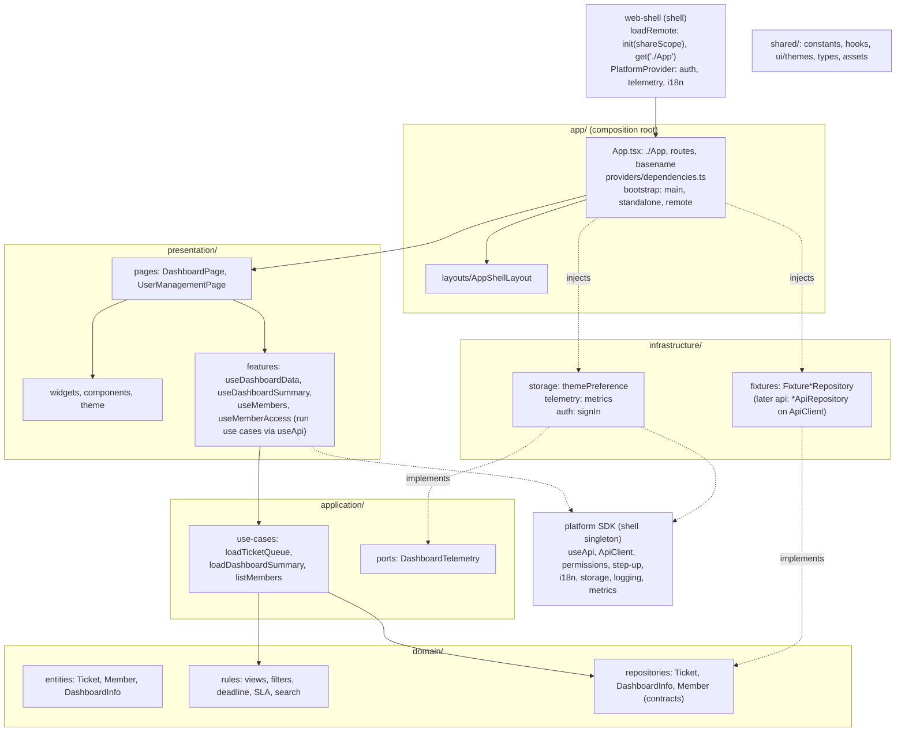
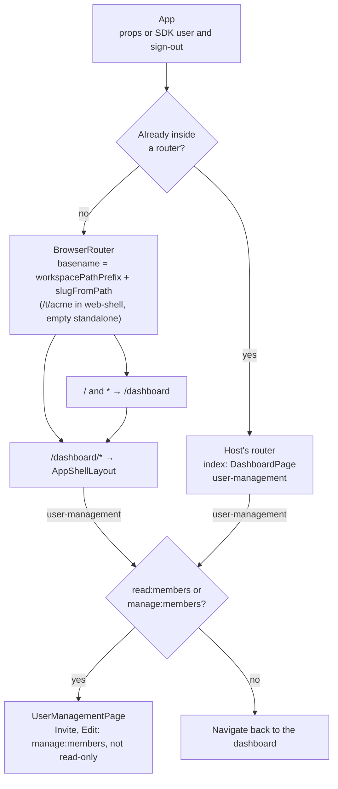
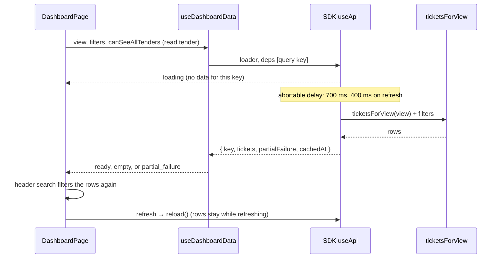

# Architecture

`mfe-dashboard` is the Module Federation remote **`dashboard`**. The shell (`web-shell`, container `app1`, built on the platform SDK) loads `remoteEntry.js` and renders `./App`. This repo does not sign users in and does not call a backend yet: ticket, KPI, notification, delegation and user rows are fixtures in the bundle. Everything the platform SDK (platform-reactcommon) provides is used from the SDK, not reimplemented here.

Exact behaviour, the runtime contract and open items are in the [LLD](docs/lld/mfe-dashboard-lld.md). Diagram sources live in [docs/architecture/mermaid/](docs/architecture/mermaid); the fences below must equal those files (`test/unit/docs/diagrams.test.ts` checks it).

## Layers

The Frontend Architecture Constitution's layers (ADR [0001](docs/adr/0001-layered-structure.md)); `test/unit/architecture/layers.test.ts` enforces the directions. Assessment and migration: [docs/architecture/constitution-assessment.md](docs/architecture/constitution-assessment.md).

> Source: `docs/architecture/mermaid/layer-model.mmd`

| Layer | Contents | May import |
|---|---|---|
| `src/app/` | Composition root. `App.tsx`: the exposed `./App` (props `userLabel?`, `onLogout?`), routes, the workspace basename, `DependenciesProvider`. `bootstrap/`: `main.tsx` (standalone entry), `standalone.ts` (runtime config, page identity), `remote.ts` (the remote build's placeholder entry). `layouts/AppShellLayout.tsx` (sidebar, search, theme, user menu, logout). `providers/dependencies.ts` (which implementation backs each contract). `configuration/` (i18n catalog). `styles/` | every layer |
| `src/presentation/` | `pages/` (DashboardPage, UserManagementPage), `widgets/dashboard/` (TicketRow, DashboardRightPanel), `components/` (BrandLogo, ThemePicker, DashboardIcons), `features/` (useDashboardData, useDashboardSummary, useDashboardInfo, useMembers, useMemberAccess: run use cases through the SDK's `useApi`), `theme/` (show a theme, Aura CSS), `dependencies.tsx` (the injected contracts) | application, domain, shared |
| `src/application/` | `use-cases/` (loadTicketQueue, loadDashboardSummary, listMembers), `ports/` (DashboardTelemetry). No React, no browser, no SDK | domain, shared |
| `src/domain/` | `entities/` (Ticket, Member, DashboardInfo), `rules/` (views, filters and deadline, SLA, search), `repositories/` (contracts). Pure TypeScript | nothing |
| `src/infrastructure/` | `fixtures/` (Fixture*Repository: today's sample data), `storage/themePreference.ts` (SDK `storage()`), `telemetry/metrics.ts` (SDK metrics, the telemetry adapter), `auth/signIn.ts` (logout without a shell) | application, domain, shared |
| `src/shared/` | `constants/app.ts` (`APP_ID`), `hooks/` (useDismiss, useFocusTrap, useNow), `ui/themes.ts`, `types/appShellContext.ts`, `assets/` | nothing of ours |
| `nginx/default.conf` | Port 8080, `/healthz`, no-cache `remoteEntry.js`, immutable hashed chunks, CORS, the platform SPA rule | — |

### What comes from the SDK

| Concern | SDK API |
|---|---|
| User, sign-out | `useCurrentUser`, `useSignOut` |
| Workspace basename, route names | `slugFromPath`, `tryGetConfig().auth.workspacePathPrefix`, `useRouteTemplate` |
| Access | `useHasPermission`, `useReadOnly`, `useStepUp` |
| Data loading, errors | `useApi`, `isProblemError` (`/problem`), `problemMessage`, `getLogger` (a failed load is logged) |
| Render errors | `MFEErrorBoundary`: around the routed page (reset on path change) and, standalone, around `App` |
| Text, dates, numbers | `registerNamespace`, `useT`, `useLocale`, `formatDate`, `formatNumber` |
| Per-app storage | `storage('dashboard')` |

`npm run lint` (platform ESLint rules) and `test/unit/sdk/dependency-rules.test.ts` reject the usual reimplementations: `Intl` formatters, `fetch`, token or cookie reading, role-name checks, raw browser storage, hand-built workspace paths, SDK deep imports, metrics not through `frontend-sdk/metrics` in `src/infrastructure/telemetry/metrics.ts`, host-page start-up outside `src/app/bootstrap/standalone.ts`, shell-only SDK APIs, and any `console` call or calendar day turned into a `Date`.

## Federation

Rsbuild 2 with the SDK's plugin (`rsbuild.config.ts`, `pluginPlatform({ role: 'remote', name: 'dashboard', exposes: { './App': './src/App.tsx' } })`), Module Federation v1. One `rsbuild build` makes two environments: **remote** (`remoteEntry.js` and chunks; the SDK from the shell) and **standalone** (`index.html` and `assets/`; the SDK bundled).

- `remoteEntry.js` defines `var __platform_mfe_dashboard` synchronously. Only async chunks are split: a split entry would start asynchronously and leave `window.__platform_mfe_dashboard` a Promise, which `loadRemote` refuses. The dev server has no HMR or live-reload client for the same reason.
- The remote consumes `react` and `react/jsx-runtime` (`^19.0.0`) and eight SDK subpaths (`auth`, `config`, `i18n`, `logging`, `metrics`, `problem`, `react`, `storage`; `^1.0.0-alpha.6`, `import: false`) from the shell. There is no fallback copy of the SDK: without the shell's, the load fails.
- `react-router-dom` is not shared; the remote runs its own router.
- `test/integration/remote-entry.test.tsx` builds the remote and loads it through `init(shareScope)` / `get('./App')`, as web-shell does.

## Routing

> Source: `docs/architecture/mermaid/routing.mmd`

`useInRouterContext()` is the branch. web-shell does not share `react-router-dom`, so inside it the remote mounts its own `BrowserRouter` at the workspace prefix: `/t/<slug>/dashboard` and `/t/<slug>/dashboard/user-management`. A host that shares a router gets relative routes. Standalone there is no runtime config, so no basename, and `/` and unknown paths redirect to `/dashboard`.

Sidebar links are absolute under the basename (`/dashboard`, `/dashboard/user-management`). "All Tenders In Flight" needs `read:tender`. User management follows IAM LLD §10.4 through web-shell's role map (`src/platform/permissions.ts`): any active member views, `tenant_admin` and `tenant_owner` manage.

## Ticket load

> Source: `docs/architecture/mermaid/ticket-load.mmd`

`ticketsForView` in `src/infrastructure/fixtures/tickets.ts`:

| View | Rows |
|---|---|
| `my-tickets` | `status === 'open'` and not delegated, sorted by SLA then due date |
| `awaiting-review` | `status === 'review'` |
| `awaiting-approval` | `status === 'approval'` (step-up banner when `useStepUp().needed`) |
| `delegated` | `delegatedFrom` is set |
| `all-tenders` | every fixture when the user has `read:tender`, otherwise `[]` |
| anything else | `[]` |

Load state is `partial_failure` when the view is `my-tickets` and a row has `tenderDetailsUnavailable` (ticket `T-1015`). Status, department, role (`roleLevel.includes`) and tender title are applied in the hook; filter options are derived from the data. Deadline is applied by local calendar day (`overdue`: before today; `week`: today and the next six days). The search box filters title, client and department after the hook returns. KPI numbers are `kpiCounts()` in `src/infrastructure/fixtures/dashboardInfo.ts`: each view's row count, from the same rows the list shows.

## Logout and theme

`onLogout` from the host runs as-is. Without it, `App` calls the SDK's `useSignOut()` (global sign-out); when that rejects because no shell provides `signOut`, `goToSignIn()` (`src/infrastructure/auth/signIn.ts`) runs: `window.location.assign`, without a trailing slash, of the runtime config's `auth.signInUrl` (per environment), else the page root `/`. Nothing environment-specific is compiled in (ADR 0006). Only the standalone page has a config with `signInUrl`: `src/app/bootstrap/standalone.ts` loads `/config/runtime.json` through the SDK, sets the page identity in the file's `environment`, then the config, before rendering, and renders anyway when that fails. Inside web-shell the shell's config applies and has no `signInUrl`.

| Key | Values |
|---|---|
| `appTheme` | `light`, `dark`, or a daisyUI theme id |
| `themeMode` | `light` or `dark`, written only for Aura themes |

`readStoredAppTheme` prefers `appTheme`, then `themeMode`, then `light`. Start and mount only show the stored theme (`showAppTheme`); only a user's choice writes storage (`saveAppTheme`).

## Browser storage

| Key | Store | Contents |
|---|---|---|
| `appTheme` | SDK `storage('dashboard')` (`localStorage`, namespaced per workspace) | Theme id |
| `themeMode` | SDK `storage('dashboard')` | `light` or `dark` |

The SDK clears both on sign-out and workspace switch, refuses token-like keys, and writes nothing while anonymous (standalone). No tokens are written. Search text stays in React state.

## Image

nginx sends `nosniff` and `Referrer-Policy` on every response, and on the standalone document a same-origin-only CSP (`frame-ancestors 'none'`), `X-Frame-Options: DENY`, `Permissions-Policy` and `X-Robots-Tag: noindex` (`nginx/document-headers.conf`); gzip is on and `server_tokens` off. Routing follows the platform's SPA rule (platform-reactcommon `examples/cloudfront/spa-rewrite.js`): only a path without a static-asset extension gets `index.html`; a missing file, anything under `/api`, `/otel`, `/csp-report`, `/config`, `/remotes`, and dotfiles are `404`. Fonts are self-hosted (`@fontsource-variable/geist` and `/inter`, standalone only; the same packages and Tailwind font stack as web-shell). Each build writes `remote-manifest-entry.json`: web-shell's manifest entry for this build with `remoteEntry.js`'s sha384 integrity, which the smoke script compares with the served file. The smoke script checks the headers.

`Dockerfile` builds with Node 26 (`npm ci` with the BuildKit secret `npm_token` for GitHub Packages), deletes source maps, and copies `dist` into `nginxinc/nginx-unprivileged:1.31-alpine` after `apk upgrade`. `USER 101`, port 8080. Build args: `BUILD_VERSION`, `SOURCE_DATE_EPOCH`. Nothing environment-specific is a build arg: the standalone page's environment and sign-in URL come from `runtime.json`. `/config/runtime.json` is served `no-cache` and is a 404 when absent; an environment mounts its own file over the shipped default to set `auth.signInUrl`. `.dockerignore` excludes `.env`.

## Release

A tag `vX.Y.Z` runs `release.yml`: validate, build the `dist` tarball and `remote-manifest-entry.json`, push the image by digest with BuildKit SBOM and SLSA provenance, scan it with Trivy, export the provenance, sign it with Cosign, then tag it (`X.Y.Z`, `X.Y`, `X`, `latest`) and create the GitHub Release. No deploy job: an environment takes the manifest entry from the same release and ships it with a web-shell on the same platform packages. Job detail: [LLD §12.5](docs/lld/mfe-dashboard-lld.md#125-release), [docs/pipeline/README.md](docs/pipeline/README.md).

## Failure domains

| Failure | What the user sees |
|---|---|
| Fixture row marked `tenderDetailsUnavailable` | Banner "Tickets are retained below" and the right-panel error. The row stays |
| Filters match nothing | "No tickets found" |
| Search matches nothing | "No matching tickets" |
| No member permission | User management link hidden; the route returns to the dashboard |
| Ticket load fails with an API error (problem, timeout, network) | Alert "Tickets could not be loaded." with the SDK's `problemMessage` for a problem, and Retry |
| Ticket loader throws anything else | `useApi` rethrows it to the page's `MFEErrorBoundary` (`AppShellLayout`); the sidebar keeps working and the error clears on navigation |
| No shell `signOut` | Logout navigates to the runtime config's `auth.signInUrl`, else `/` |
| `#app` missing in standalone bootstrap | `main.tsx` throws before render |
| Shell lacks a shared SDK subpath, or its SDK / React is outside the remote's range | `get('./App')` or the singleton check fails; the shell's `RemoteBoundary` shows the error |

## Invariants

- Container `dashboard`, expose `./App`, `var __platform_mfe_dashboard` defined synchronously. The global's name comes from the preset and must match the shell's SDK, so this remote and web-shell upgrade the platform packages together.
- The SDK is never bundled into the remote and never a runtime dependency; its dev version equals web-shell's.
- `onLogout` and `userLabel` are optional.
- Images and fonts are imported, never root-relative, so they load from the remote's origin inside the shell.
- No role names in `src/`; access is by permission.
- Every UI string is in `src/app/configuration/locales/en.json`, and every key there is used.
- `/healthz` returns `ok` on port 8080.
- Coverage gate is 95% on all four metrics, enforced by `.github/scripts/coverage-gate.mjs`.

Each is checked by a test or a CI job: [test/README.md](test/README.md), [docs/pipeline/README.md](docs/pipeline/README.md).

## Testing

Laid out like platform-reactcommon's `test/`: `test/unit/<area>`, `test/integration`, `test/e2e`, `test/fixtures` ([test/README.md](test/README.md)). Every test runs against a fresh SDK test platform (`createTestPlatform`). The integration suite builds the remote with Rsbuild in a child process; `vitest.config.ts` itself does not load `rsbuild.config.ts`. The Docker image is smoke-tested in CI.

## Threat notes

| Item | Note |
|---|---|
| `auth.signInUrl` | From the environment's `runtime.json`, validated by the SDK (`https`, `http` only for local, dev and test). Logout is an open navigation to it. Never take it from the query string |
| Theme in SDK storage | Any script in the page origin can read it. It is not a credential, and the SDK clears it on sign-out |
| Mock data | Sample names and emails. They are not accounts |
| Remote execution | The shell runs this bundle in the shell origin and pins `remoteEntry.js` by SRI in its manifest; this image is signed (see [VERSIONING.md](VERSIONING.md)) |
| Permissions | UI hints only. IAM and the APIs authorise every request |

## Decisions

| Decision | Why |
|---|---|
| Use the platform SDK for user, sign-out, access, data loading, text, storage and routing | One implementation across shell and remotes; the SDK is the shell's singleton, so state (session, locale, storage namespace) is shared |
| Own `BrowserRouter` under the workspace prefix | The SDK does not share `react-router-dom`; the basename is computed exactly as web-shell computes it |
| Two Rsbuild environments | The remote must not bundle the SDK; the standalone page has no shell to provide it |
| Access by `read:members` / `manage:members`, not roles | IAM owns roles and web-shell owns the role map; the remote only names the permission it needs |
| Logical layout classes (`ps/pe`, `start/end`, `text-start`) | The layout follows the page's `dir`, so an RTL locale needs no separate stylesheet |
| Custom chrome inside the remote | The shell renders only the frame; ticket navigation lives here |
| `USER 101` | The unprivileged nginx image's uid. `USER nginx` fails Hadolint DL3066 |
| Constitution layers (`app`, `presentation`, `application`, `domain`, `infrastructure`, `shared`), enforced by a test | Business rules independent of React and the SDK; data access behind repositories; ADR [0001](docs/adr/0001-layered-structure.md), [0004](docs/adr/0004-repositories-and-composition-root.md) |
| Platform SDK `useApi` for server state, React state for UI state (not TanStack Query or Zustand) | One request lifecycle with the shell; small local state. ADR [0002](docs/adr/0002-server-state-platform-sdk.md), [0003](docs/adr/0003-client-state-react.md) |
| Runtime configuration only | Build once, deploy everywhere. ADR [0006](docs/adr/0006-runtime-configuration-only.md) |
| Coverage script instead of a Vitest threshold | Same gate the shell uses, overridable with `COVERAGE_THRESHOLD` |
| Standalone build `assetPrefix: '/'`, remote left at the preset's `'auto'` | The remote is loaded from any base URL; the standalone page is always at `/`, and relative asset URLs break a reload of `/dashboard/user-management` |
| Provenance read from the image index (`imagetools inspect`), not with `cosign download attestation` | `build-push-action` writes provenance as a BuildKit attestation, not a Cosign one; the Cosign call found nothing and failed `v0.1.0` |
| Release images are pushed by digest and tagged only after scan, provenance and signature | A version tag or `latest` never points at an unscanned or unsigned image (`v0.1.0` did) |
| A failed release is fixed by the next patch version, not by moving the tag | A rerun checks out the same tag and scripts, and moving a tag needs a force push |

## Documentation

[docs/README.md](docs/README.md) indexes the LLD, the diagram sources, the pipeline map and the runbooks. Guidance for Claude Code is in [.claude/CLAUDE.md](.claude/CLAUDE.md).
