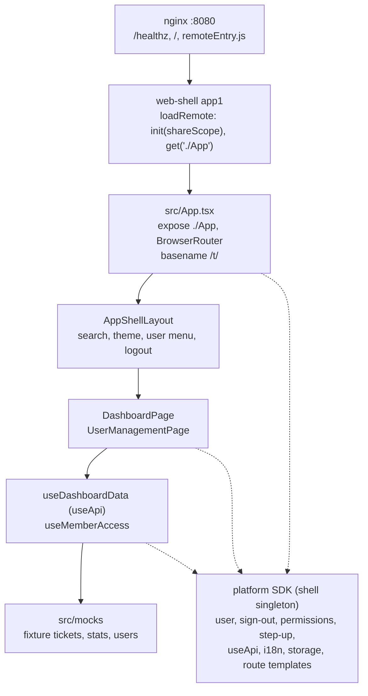
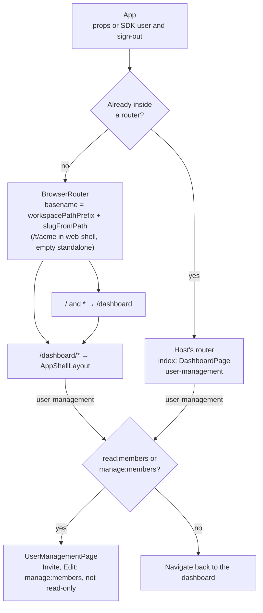
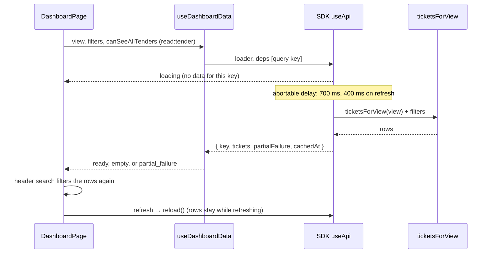

# Architecture

`mfe-dashboard` is the Module Federation remote **`app2`**. The shell (`web-shell`, container `app1`, built on the platform SDK) loads `remoteEntry.js` and renders `./App`. This repo does not sign users in and does not call a backend yet: ticket, KPI, notification, delegation and user rows are fixtures in the bundle. Everything the platform SDK (platform-reactcommon) provides is used from the SDK, not reimplemented here.

Exact behaviour, the runtime contract and open items are in the [LLD](docs/lld/mfe-dashboard-lld.md). Diagram sources live in [docs/architecture/mermaid/](docs/architecture/mermaid); the fences below must equal those files (`test/unit/docs/diagrams.test.ts` checks it).

## Layers

> Source: `docs/architecture/mermaid/layer-model.mmd`

| Module | Responsibility |
|---|---|
| `src/App.tsx` | Exposed `./App` and the standalone root. Props `userLabel?`, `onLogout?`; otherwise `useCurrentUser` and `useSignOut` from the SDK. Uses the host's router when there is one, otherwise its own `BrowserRouter` with `workspaceBasename()` (`workspacePathPrefix` + `slugFromPath`, as web-shell). Registers the route template for user management |
| `src/main.tsx` | Standalone entry: applies the stored theme, then mounts `<App />` on `#app`. Throws if `#app` is missing. The shell never runs it |
| `src/remote.ts` | The remote build's placeholder entry (Rsbuild needs one; the shell loads only `remoteEntry.js`) |
| `src/i18n.ts`, `src/locales/en.json` | The `app2` namespace (`registerNamespace`); every UI string |
| `src/layouts/AppShellLayout.tsx` | Sidebar, search box, theme picker, user menu, logout. Publishes `{ search }` on the outlet context. `defaultLogout()` is the no-shell fallback |
| `src/pages/DashboardPage.tsx` | Views, KPI cards, filter drawer, step-up banner, empty / loading / partial states, right panel |
| `src/pages/UserManagementPage.tsx` | Member table filtered by the outlet search; Invite and Edit only for `canManage` |
| `src/hooks/useDashboardData.ts` | Tickets through the SDK's `useApi` (fixture loader with an abortable delay) |
| `src/hooks/useMemberAccess.ts` | `canView` (`read:members` or `manage:members`), `canManage` (`manage:members` and not `useReadOnly()`) |
| `src/theme/themeMode.ts` | `appTheme` and `themeMode` in the SDK's `storage('app2')` |
| `nginx/default.conf` | Port 8080, `/healthz`, no-cache `remoteEntry.js`, immutable hashed chunks, CORS |

### What comes from the SDK

| Concern | SDK API |
|---|---|
| User, sign-out | `useCurrentUser`, `useSignOut` |
| Workspace basename, route names | `slugFromPath`, `tryGetConfig().auth.workspacePathPrefix`, `useRouteTemplate` |
| Access | `useHasPermission`, `useReadOnly`, `useStepUp` |
| Data loading, errors | `useApi`, `isProblemError` (`/problem`), `problemMessage` |
| Text, dates, numbers | `registerNamespace`, `useT`, `useLocale`, `formatDate`, `formatNumber` |
| Per-app storage | `storage('app2')` |

`npm run lint` (platform ESLint rules) and `test/unit/sdk/dependency-rules.test.ts` reject the usual reimplementations: `Intl` formatters, `fetch`, token or cookie reading, role-name checks, raw browser storage, hand-built workspace paths, SDK deep imports.

## Federation

Rsbuild 2 with the SDK's plugin (`rsbuild.config.ts`, `pluginPlatform({ role: 'remote', name: 'app2', exposes: { './App': './src/App.tsx' } })`), Module Federation v1. One `rsbuild build` makes two environments: **remote** (`remoteEntry.js` and chunks; the SDK from the shell) and **standalone** (`index.html` and `assets/`; the SDK bundled).

- `remoteEntry.js` defines `var app2` synchronously. Only async chunks are split: a split entry would start asynchronously and leave `window.app2` a Promise, which `loadRemote` refuses. The dev server has no HMR or live-reload client for the same reason.
- The remote consumes `react` and `react/jsx-runtime` (`^19.0.0`) and six SDK subpaths (`auth`, `config`, `i18n`, `problem`, `react`, `storage`; `^1.0.0-alpha.3`, `import: false`) from the shell. There is no fallback copy of the SDK: without the shell's, the load fails.
- `react-router-dom` is not shared; the remote runs its own router.
- `test/integration/remote-entry.test.tsx` builds the remote and loads it through `init(shareScope)` / `get('./App')`, as web-shell does.

## Routing

> Source: `docs/architecture/mermaid/routing.mmd`

`useInRouterContext()` is the branch. web-shell does not share `react-router-dom`, so inside it the remote mounts its own `BrowserRouter` at the workspace prefix: `/t/<slug>/dashboard` and `/t/<slug>/dashboard/user-management`. A host that shares a router gets relative routes. Standalone there is no runtime config, so no basename, and `/` and unknown paths redirect to `/dashboard`.

Sidebar links are absolute under the basename (`/dashboard`, `/dashboard/user-management`). "All Tenders In Flight" needs `read:tender`. User management follows IAM LLD §10.4 through web-shell's role map (`src/platform/permissions.ts`): any active member views, `tenant_admin` and `tenant_owner` manage.

## Ticket load

> Source: `docs/architecture/mermaid/ticket-load.mmd`

`ticketsForView` in `src/mocks/dashboardTickets.ts`:

| View | Rows |
|---|---|
| `my-tickets` | `status === 'open'` and not delegated, sorted by SLA then due date |
| `awaiting-review` | `status === 'review'` |
| `awaiting-approval` | `status === 'approval'` (step-up banner when `useStepUp().needed`) |
| `delegated` | `delegatedFrom` is set |
| `all-tenders` | every fixture when the user has `read:tender`, otherwise `[]` |
| anything else | `[]` |

Load state is `partial_failure` when the view is `my-tickets` and a row has `tenderDetailsUnavailable` (ticket `T-1015`). Status, department, role (`roleLevel.includes`) and tender title are applied in the hook; filter options are derived from the data. **Deadline is counted by `countActiveFilters` and is not applied.** The search box filters title, client and department after the hook returns. KPI numbers are `KPI_COUNTS` in `src/mocks/dashboardStats.ts`, not the row count.

## Logout and theme

`onLogout` from the host runs as-is. Without it, `App` calls the SDK's `useSignOut()` (global sign-out); when that rejects because no shell provides `signOut`, `defaultLogout()` runs: `window.location.assign` of `VITE_APP1_URL` without a trailing slash (default `http://localhost:5001`, inlined at build by `source.define`).

| Key | Values |
|---|---|
| `appTheme` | `light`, `dark`, or a daisyUI theme id |
| `themeMode` | `light` or `dark`, written only for Aura themes |

`readStoredAppTheme` prefers `appTheme`, then `themeMode`, then `light`.

## Browser storage

| Key | Store | Contents |
|---|---|---|
| `appTheme` | SDK `storage('app2')` (`localStorage`, namespaced per workspace) | Theme id |
| `themeMode` | SDK `storage('app2')` | `light` or `dark` |

The SDK clears both on sign-out and workspace switch, refuses token-like keys, and writes nothing while anonymous (standalone). No tokens are written. Search text stays in React state.

## Image

nginx sends `nosniff` and `Referrer-Policy` on every response, and on the standalone document a same-origin-only CSP (`frame-ancestors 'none'`), `X-Frame-Options: DENY`, `Permissions-Policy` and `X-Robots-Tag: noindex` (`nginx/document-headers.conf`); gzip is on and `server_tokens` off. Fonts are self-hosted (`@fontsource`, standalone only). The smoke script checks the headers.

`Dockerfile` builds with Node 26 (`npm ci` with the BuildKit secret `npm_token` for GitHub Packages), deletes source maps, and copies `dist` into `nginxinc/nginx-unprivileged:1.31-alpine` after `apk upgrade`. `USER 101`, port 8080. Build args: `VITE_APP1_URL` (default `http://localhost:5001`), `BUILD_VERSION`, `SOURCE_DATE_EPOCH`. `.dockerignore` excludes `.env`, so values come in as build args.

## Failure domains

| Failure | What the user sees |
|---|---|
| Fixture row marked `tenderDetailsUnavailable` | Banner "Tickets are retained below" and the right-panel error. The row stays |
| Filters match nothing | "No tickets found" |
| Search matches nothing | "No matching tickets" |
| No member permission | User management link hidden; the route returns to the dashboard |
| Ticket load fails with an API error (problem, timeout, network) | Alert "Tickets could not be loaded." with the SDK's `problemMessage` for a problem, and Retry |
| Ticket loader throws anything else | `useApi` rethrows it to the shell's `RemoteBoundary` |
| No shell `signOut` | Logout navigates to `VITE_APP1_URL` |
| `#app` missing in standalone bootstrap | `main.tsx` throws before render |
| Shell lacks a shared SDK subpath, or its SDK / React is outside the remote's range | `get('./App')` or the singleton check fails; the shell's `RemoteBoundary` shows the error |

## Invariants

- Container `app2`, expose `./App`, `var app2` defined synchronously.
- The SDK is never bundled into the remote and never a runtime dependency; its dev version equals web-shell's.
- `onLogout` and `userLabel` are optional.
- No role names in `src/`; access is by permission.
- Every UI string is in `src/locales/en.json`, and every key there is used.
- `/healthz` returns `ok` on port 8080.
- Coverage gate is 95% on all four metrics, enforced by `.github/scripts/coverage-gate.mjs`.

Each is checked by a test or a CI job: [test/README.md](test/README.md), [docs/pipeline/README.md](docs/pipeline/README.md).

## Testing

Laid out like platform-reactcommon's `test/`: `test/unit/<area>`, `test/integration`, `test/e2e`, `test/fixtures` ([test/README.md](test/README.md)). Every test runs against a fresh SDK test platform (`createTestPlatform`). The integration suite builds the remote with Rsbuild in a child process; `vitest.config.ts` itself does not load `rsbuild.config.ts`. The Docker image is smoke-tested in CI.

## Threat notes

| Item | Note |
|---|---|
| `VITE_APP1_URL` | Fixed at build. Logout is an open navigation to that origin. Do not take it from the query string |
| Theme in SDK storage | Any script in the page origin can read it. It is not a credential, and the SDK clears it on sign-out |
| Mock data | Sample names and emails. They are not accounts |
| Remote execution | The shell runs this bundle in the shell origin and pins `remoteEntry.js` by SRI in its manifest; this image is signed (see [VERSIONING.md](VERSIONING.md)) |
| Permissions | UI hints only. IAM and the APIs authorise every request |

## Decisions

| Decision | Why |
|---|---|
| Use the platform SDK for user, sign-out, access, data loading, text, storage and routing | One implementation across shell and remotes; the SDK is the shell's singleton, so state (session, locale, storage namespace) is shared |
| Own `BrowserRouter` under the workspace prefix | The SDK does not share `react-router-dom`; the basename is computed exactly as web-shell computes it |
| Two Rsbuild environments | The remote must not bundle the SDK; the standalone page has no shell to provide it |
| Access by `read:members` / `manage:members`, not roles | IAM owns roles and web-shell owns the role map; the remote only names the permission it needs |
| Custom chrome inside the remote | The shell renders only the frame; ticket navigation lives here |
| `USER 101` | The unprivileged nginx image's uid. `USER nginx` fails Hadolint DL3066 |
| Coverage script instead of a Vitest threshold | Same gate the shell uses, overridable with `COVERAGE_THRESHOLD` |
| Deadline counted but not applied | The badge reflects the control; the hook has no deadline predicate yet (LLD §15) |

## Documentation

[docs/README.md](docs/README.md) indexes the LLD, the diagram sources, the pipeline map and the runbooks. Guidance for Claude Code is in [.claude/CLAUDE.md](.claude/CLAUDE.md).
