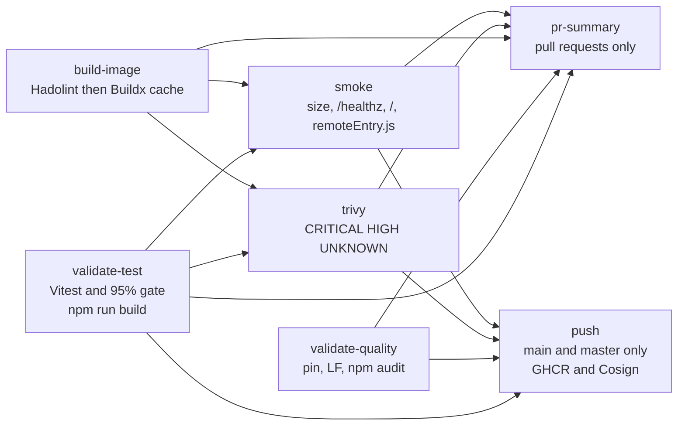
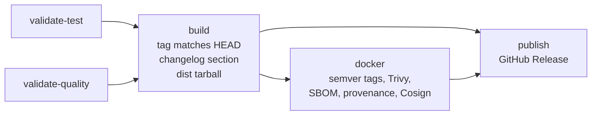

# Pipeline

How GitHub Actions builds, tests, and publishes `mfe-dashboard`. Workflows live in [`.github/workflows/`](../../.github/workflows). Scripts they call live in [`.github/scripts/`](../../.github/scripts).

Five workflow files. Markdown-only pushes and pull requests skip `ci.yml` (`paths-ignore: '**.md'`). A commit that also touches code still runs.

| Workflow | When | What it decides |
|---|---|---|
| [`ci.yml`](../../.github/workflows/ci.yml) | Pull request or push to `main` or `master`, or a manual run | Tests, image, scan, smoke. Push to `main` also publishes and signs |
| [`validate-test.yml`](../../.github/workflows/validate-test.yml) | Called by `ci.yml` and `release.yml` | Vitest, the 95% coverage gate, then `npm run build` |
| [`validate-quality.yml`](../../.github/workflows/validate-quality.yml) | Called by `ci.yml` and `release.yml` | Workflow hygiene, digest-pinned `FROM` lines, production `npm audit` |
| [`changelog-check.yml`](../../.github/workflows/changelog-check.yml) | Pull request touching `src/`, the lockfile, the Dockerfile, nginx, `rsbuild.config.ts`, or `index.html` | `CHANGELOG.md` is in the diff |
| [`release.yml`](../../.github/workflows/release.yml) | Tag `vX.Y.Z` or `vX.Y.Z-*`, or a manual run with a tag input | Changelog section, image, SBOM, provenance, GitHub Release |

Dependabot opens pull requests for npm, Docker, and GitHub Actions (`.github/dependabot.yml`).

Node on every job is **22**. `FORCE_JAVASCRIPT_ACTIONS_TO_NODE24` is set so JavaScript actions run on the runner's current Node.

## Pull request and main

Source: [`mermaid/ci-flow.mmd`](mermaid/ci-flow.mmd).

`build-image` does not wait for the test job. Trivy and smoke wait for both the test job and the image. A test failure still skips the scan and the smoke run. `validate-quality` does not block those two. It does block `push`. The summary comment is skipped when any upstream job fails (`if` on the job).

| Job | Gate |
|---|---|
| `validate-test` | `npm ci`, `npm run test:coverage` (unit, integration with a temp build of the remote, e2e), [`.github/scripts/coverage-gate.mjs`](../../.github/scripts/coverage-gate.mjs) at 95% for statements, branches, functions, and lines, upload `coverage/`, then `npm run build` (`tsc` and `rsbuild build`). See [the coverage runbook](../runbook-coverage-gate.md) |
| `validate-quality` | No HTML entities in workflows or scripts. LF in `.github/scripts`, `.github/workflows`, `Dockerfile`, and `nginx/`. Every `FROM` is `image:tag@sha256:…`. `.dockerignore` exists. `npm audit --omit=dev --audit-level=high` |
| `build-image` | Hadolint on `Dockerfile`, then a `linux/amd64` build tagged `mfe-dashboard-ci-test` and stored in the Actions cache. Build arg: `VITE_APP1_URL` from the repository variable, otherwise `http://localhost:5001`. Secret `npm_token` (`GITHUB_TOKEN`, `packages: read`) for the preset on GitHub Packages |
| `trivy` | Reloads that cached image. Fails on unfixed **CRITICAL**, **HIGH**, or **UNKNOWN**. SARIF is uploaded and does not fail the job by itself. CycloneDX SBOM is an artifact named `sbom-<sha>`. Allowlist file: [`.trivyignore`](../../.trivyignore). See [the image runbook](../runbook-image-scan.md) |
| `smoke` | Same cached image. [`.github/scripts/smoke-tests.sh`](../../.github/scripts/smoke-tests.sh): at most 200 MB, `GET /healthz` contains `ok`, `GET /` is 200 and contains `id="app"`, `GET /remoteEntry.js` is 200 and starts with `var app2`, no `.map` file in the image |
| `pr-summary` | [`.github/scripts/pr-summary.js`](../../.github/scripts/pr-summary.js) posts one comment. The coverage cell uses the `pct` output of `validate-test` |
| `push` | Push events on `main` or `master` only. Publishes `ghcr.io/bcbp-solutions-fzc-llc/mfe-dashboard` with the branch tag and `sha-<short>`, `provenance` and `sbom` on the build, then Cosign keyless sign and verify. The verify identity is `refs/heads/main` or `refs/heads/master` |

Concurrency group `ci-<workflow>-<ref>` cancels an older run on the same ref.

## Release

Source: [`mermaid/release-flow.mmd`](mermaid/release-flow.mmd).

`verify-release-tag.sh` requires `RELEASE_TAG` to equal `git describe --tags --exact-match`. `extract-release-notes.sh` prints the body under `## [X.Y.Z]` and fails when that section is empty. The image tags drop the leading `v` (`{{version}}`). `latest` is applied only when the tag has no `-`. Release Trivy is **CRITICAL** and **HIGH** (it does not include `UNKNOWN`). The GitHub Release asset is `mfe-dashboard_<tag>_dist.tar.gz` plus checksums. Publish waits for the image job. There is no deploy job.

Checkout uses `secrets.CI_REPO_READ_TOKEN` when set, otherwise `github.token`.

## Local equivalents

| CI step | Local command |
|---|---|
| Coverage gate | `npm run test:ci` |
| Production build | `npm run build` |
| Pre-commit checks | `npm run hooks:install`, then commit |
| Image | `docker build -t mfe-dashboard:dev .` |

The hook does not replace `npm run test:ci`.
